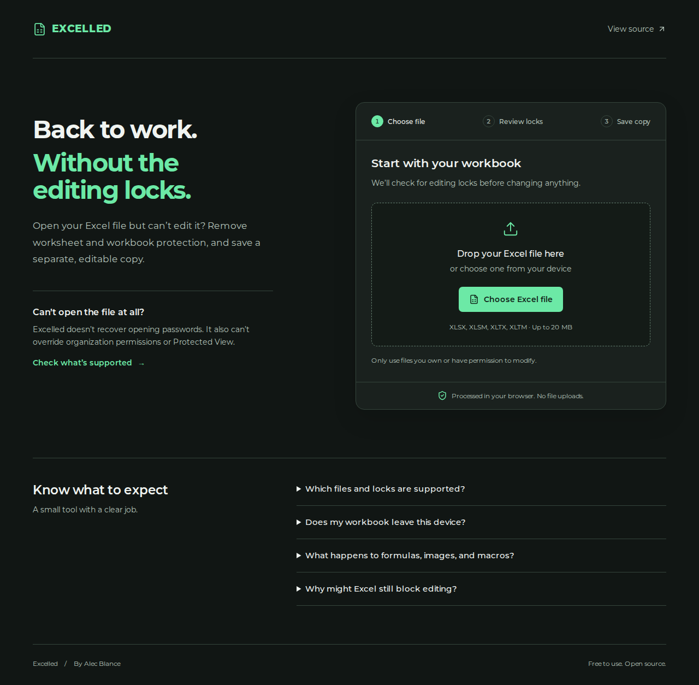

# 📄 Excelled

Remove worksheet and workbook editing locks from Excel files you own or have permission to modify. Everything runs in your browser, so your workbook is never uploaded.

**Open:** http://excelled.alecblance.com

> **Not password recovery.** Excelled can’t decrypt opening passwords, override organization permissions, remove Protected View, or unlock VBA projects.

## Usage

1. Open http://excelled.alecblance.com
2. Choose or drop an unencrypted `.xlsx`, `.xlsm`, `.xltx`, or `.xltm` file.
3. Review the detected locks and select which ones to remove.
4. Create and download the editable copy. Your original file stays unchanged.

Try the included [`cant edit.xlsx`](sample/cant%20edit.xlsx) sample.

## Screenshots



## Supported

- Unencrypted `.xlsx`, `.xlsm`, `.xltx`, and `.xltm` workbooks
- Worksheet editing locks and workbook structure/window protection

Unsupported: opening passwords, `.xls`/`.xlsb`, signed packages, chart sheets, VBA locks, IRM/Protected View, and nonstandard package layouts. Macro and template support is beta; check the copied file in Excel before sharing.

Files are limited to 20 MB, with additional safety limits on expanded contents. Passwords, sheet names, and files never leave your device. The old `/api` upload endpoint is retired.

## Run Locally

```bash
git clone https://github.com/AlecBlance/Excelled-web
cd Excelled-web
npm install
npm run dev
```

Checks: `npm run lint`, `npm run typecheck`, `npm test`, `npm run build`, and `npm run test:e2e`.

## Tech Stack

**Client:** React, Next.js, TailwindCSS

**Libraries:** fflate, @xmldom/xmldom

Created by [@AlecBlance](https://github.com/AlecBlance). [MIT](LICENSE)
